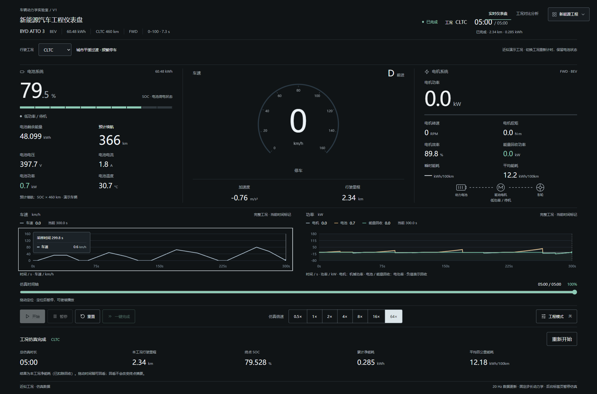
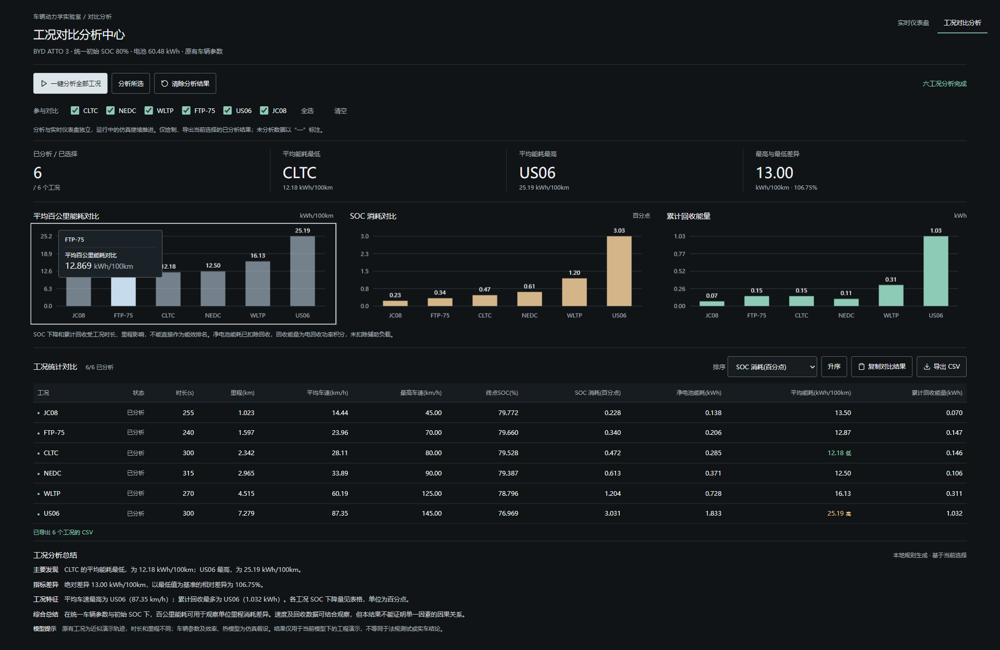

# 新能源汽车多工况可视化仪表盘

**Electric Vehicle Driving Cycle Simulation and Interactive Visualization Dashboard**

基于 [TheBorba/obd-react-panel](https://github.com/TheBorba/obd-react-panel) 二次开发的 React + TypeScript 工程，用于演示新能源汽车工况仿真、车辆能量变化与多工况对比分析。

> 工况为近似演示轨迹，车辆效率与热模型采用简化假设。本项目不是实车测试、法规认证或官方续航预测工具。总结由本地规则生成，不调用云端 AI。

## 界面预览





## 主要功能

- CLTC、NEDC、WLTP、FTP-75、US06、JC08 六种工况。
- 车速、SOC、电池、电机、能耗、续航与驱动/回收能量流。
- 开始 / 暂停 / 重置，0.5× / 1× / 2× / 4× / 8× / 16× / 64×。
- 一键完成、时间轴回看、完成摘要、工程模式。
- Canvas 仪表和速度/功率曲线，支持采样点 Tooltip。
- 独立多工况分析：筛选、统一初始条件计算、三张对比图、排序表格及规则总结。
- 复制 TSV 到 Excel、导出 UTF-8 CSV；当前没有数据导入界面。
- 默认简体中文，保留原面板注册、经典 OBD / BYD King 主题及可选 Web Bluetooth 代码。

## 安装与启动

使用带 npm 的 Node.js 22.12+；已验证 22.23.3。精确依赖由 package-lock.json 锁定。

```bash
git clone https://github.com/3281950-debug/ev-driving-cycle-dashboard.git
cd ev-driving-cycle-dashboard
npm ci
npm run dev -- --host 127.0.0.1
```

打开终端实际输出的地址。配置首选端口 5173，占用时以 Vite 输出为准。首次安装依赖需要网络；核心仿真、数据和规则分析都在本地运行。

### 检查与生产构建

```bash
npm run typecheck
npm run lint
npm run test:run
node --test packaging/server.test.mjs
npm run build
npm run preview -- --host 127.0.0.1
```

dist 是可重建产物，不提交到 Git。请通过 HTTP 服务访问，不能直接双击 HTML。静态资源使用 /assets/ 根路径，子路径部署需要额外配置并验证。

### Windows 便携版复现

先完成 build，再在 Windows PowerShell 中执行：

```powershell
powershell -NoProfile -ExecutionPolicy Bypass -File .\packaging\build-portable.ps1 -OutputDirectory ..\Portable-Rebuilt
```

输出目录必须不存在，脚本不会覆盖已有文件。打包时下载并校验官方 Node.js x64；生成的运行包无需安装 Node、npm 或 Python。双击“启动仪表盘.vbs”，就绪后打开默认浏览器；结束时使用“关闭仪表盘.vbs”。系统禁用 VBS 时可用备用 cmd，系统脚本策略仍需满足。

便携服务绑定 127.0.0.1，端口自动分配，重复启动复用本目录实例。关闭浏览器不会停止服务。日志写入当前用户 LocalAppData。仓库不含交付 ZIP、运行时二进制或安装包。

## 使用说明

1. 选择工况，开始播放，切换倍速观察仪表和能量流。
2. 一键完成查看终点；拖动时间轴回看，定位后可继续播放。
3. 工程模式显示精确数据，图表支持悬停及左右键采样。
4. 进入工况对比分析，一键计算六工况，查看图表、表格和总结。
5. 选择参与对比的结果，排序、复制 TSV 或导出 CSV。

切换工况重新计时但保留电池及累计行程；重置恢复默认 CLTC 与初始状态。对比模块分别从 SOC 80% 独立计算，不覆盖实时状态。核对两者前先重置实时仪表。刷新会清空结果，需要保留时先导出。

## 技术架构与目录

React 19.2.8、TypeScript 5.9.3、Vite 8.3.3、Tailwind CSS、Lucide、Canvas。没有业务后端或数据库。

```text
src/
  simulation/       动力学、电池/电机状态、固定步长时间轴
  drivingCycles/    六工况样本、验证与目标速度插值
  analysis/         独立计算、统计、规则总结及序列化
  hooks/            控制状态和原有 OBD 数据控制
  components/       仪表、曲线、控制及分析视图
  panels/           面板注册与三个展示主题
  localization/     中文文案
  types/ utils/     类型与工具
packaging/          静态服务、启动器、打包脚本及测试
docs/               架构、模型、构建、验证和截图
licenses/           第三方许可文本与版本索引
package.json        开发、检查、测试及构建命令
package-lock.json   可复现依赖版本
AGENTS.md           前端设计和验收约定
LICENSE             保留的上游许可证
```

物理计算采用 0.05 s 固定步长，UI 以 20 Hz 发布；高倍速增加步数，不放大步长。一键完成和未来定位分片计算并让出事件循环。回看使用实际计算缓存，不插值伪造 SOC。计算核心与 UI 解耦。

## 模型局限

- 工况为 240–315 s 的近似演示轨迹，不是完整官方法规曲线。
- 参数、效率包络、电压与温度采用简化假设，没有实车标定、效率 MAP、坡度、轮胎滑移和老化模型。
- 预计续航为 SOC × 标称续航，不是当前工况下的动态预测。
- SOC 消耗是百分点；百公里能耗按实际里程归一化；累计回收和净电池能耗不能混淆。
- 总结不预定工况排名，不证明实车因果关系。
- 实车蓝牙需要兼容硬件、浏览器与权限，未进行硬件认证。

## 技术文档

- [架构与数据流](docs/ARCHITECTURE.md)
- [仿真公式、数据来源与限制](docs/SIMULATION.md)
- [构建与便携打包](docs/BUILD.md)
- [已执行验证和未测项](docs/VERIFICATION.md)
- [本次发布检查](docs/PUBLICATION.md)
- [原项目说明](docs/upstream-readme.md)

历史交付验证包含 73 项原测试、2 项静态服务测试、生产构建、浏览器操作、六工况核对及桌面截图；不代表全部系统、硬件和浏览器版本认证。

## 来源与许可证

保留上游 TheBorba/obd-react-panel 已有 [MIT LICENSE](LICENSE) 和版权声明，未新增或替换许可证。第三方依赖遵循各自许可，见 [THIRD-PARTY-NOTICES.md](THIRD-PARTY-NOTICES.md)。车型名称用于说明演示参数，本项目不代表车辆厂商，也没有官方背书。
